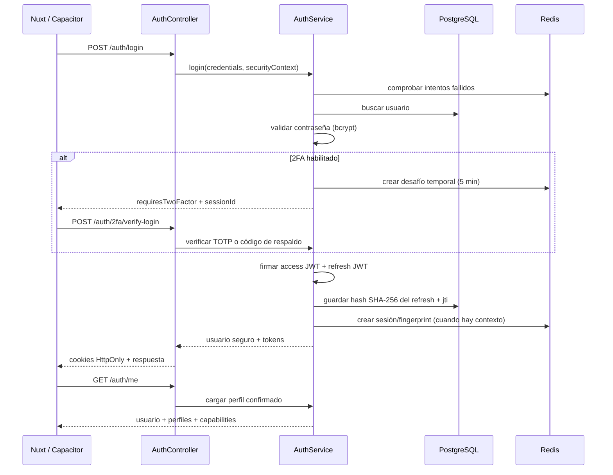

# Autenticación y autorización

Este documento describe el flujo implementado en el monorepo. La autenticación confirma **quién es el usuario**; la autorización decide **qué puede hacer** ese usuario en cada operación.

## Componentes principales

| Componente | Responsabilidad |
|---|---|
| `AuthController` | Endpoints de registro, login, Google OAuth, 2FA, refresh, logout y perfil |
| `AuthService` | Verificación de credenciales, emisión/rotación de tokens, sesiones y revocación |
| `JwtStrategy` | Valida access tokens, blacklist, estado de usuario y contexto de sesión |
| `JwtRefreshStrategy` | Extrae y valida la estructura del refresh JWT antes de consultar su registro |
| `JwtAuthGuard` / `JwtRefreshGuard` | Conectan Passport con los endpoints protegidos |
| `useAuth` | Estado de sesión Nuxt, envío de credenciales, renovación y carga de `/auth/me` |
| `PermissionsGuard` | Evalúa el permiso requerido por un endpoint |
| `PermissionsService` | Resuelve permisos por rol, perfiles y excepciones individuales |

## Flujo de inicio de sesión

### Credenciales y protección contra abuso

- La contraseña se valida contra su hash bcrypt; no se compara ni se almacena en texto plano.
- Login y registro usan límites de Nest Throttler y el guard de rate limit basado en Redis.
- Se cuentan intentos fallidos por email y se bloquea temporalmente el login al superar el umbral.
- El registro/login verifican reCAPTCHA cuando la configuración lo requiere.
- Si el usuario tiene 2FA, la autenticación queda pendiente hasta validar TOTP o consumir un código de respaldo. El desafío pendiente expira en cinco minutos.

## Access y refresh tokens

| Token | Uso | Vida predeterminada | Persistencia |
|---|---|---:|---|
| Access JWT | Autorizar requests a la API | 15 min | No se guarda como token persistente en la DB |
| Refresh JWT | Renovar access y refresh | 7 días | Solo se guarda SHA-256 del token |
| Refresh corto | Sesión sin “recordarme” | 1 día | Solo se guarda SHA-256 del token |

Ambos JWT incluyen un `jti`; el access token también incluye `sub`, email y rol. La estrategia JWT no confía en el rol del payload para autorizar: vuelve a cargar el usuario desde la base de datos.

### Transporte según cliente

- **Web:** el backend establece `access_token` y `refresh_token` como cookies `HttpOnly`, `SameSite=Lax`, con `Path=/api`; `Secure` se activa en producción. El access token también puede viajar en memoria como Bearer durante la sesión. El navegador no persiste esos tokens en localStorage.
- **Capacitor:** el frontend conserva access y refresh tokens en localStorage y los envía como Bearer / body al renovar. Este almacenamiento debe migrarse a almacenamiento seguro nativo antes de tratar la app como un cliente de alto riesgo.

El extractor de access token prioriza `Authorization: Bearer` y luego la cookie. El extractor de refresh prioriza `body.refreshToken` y luego la cookie.

## Renovación, revocación y sesiones

1. Ante un 401, `useAuth.authFetch()` intenta renovar una vez y reintenta la petición original.
2. `JwtRefreshGuard` verifica firma y expiración del refresh JWT.
3. `AuthService.refreshTokens()` busca el hash SHA-256 en DB, valida propietario, expiración y revocación.
4. La rotación consume el refresh anterior mediante un `updateMany` condicional (`revokedAt IS NULL`) y crea el reemplazo dentro de una transacción. En solicitudes concurrentes solo una puede ganar.
5. Logout revoca refresh tokens, añade sus `jti` a la blacklist Redis y limpia sesiones activas.
6. La estrategia de access token rechaza `jti` en blacklist, usuarios inactivos y sesiones expiradas. Cuando existe contexto de seguridad, se valida el fingerprint y se aplica un límite de 30 minutos de inactividad.

Los cambios de contraseña y el reset por email revocan los refresh tokens existentes. Los tokens de reset (1 hora) y verificación de email (24 horas) también se persisten como hashes SHA-256; el token original solo se entrega al usuario.

## Flujo de autorización

La autenticación no concede automáticamente acceso a módulos o acciones. Las fuentes de autorización son:

| Fuente | Qué representa |
|---|---|
| `RolePermission` | Permisos base del rol de plataforma |
| `ProfilePermission` | Permisos de cada perfil `UserProfile` ACTIVE |
| `UserPermission` | Excepción individual explícita, positiva o negativa y opcionalmente temporal |

Precedencia de autorización:

1. Override individual vigente: concede o deniega y prevalece sobre las demás fuentes.
2. Si no hay override vigente, unión de permisos del rol y de todos los perfiles activos.
3. Si ninguna fuente concede la clave, el acceso se deniega.

`@RequirePermission('menu:create')` declara el permiso en el controller; `PermissionsGuard` lo resuelve en backend. SUPERADMIN tiene bypass en este guard. Los permisos marcados `isSystem` no se pueden editar ni eliminar desde la matriz.

La jerarquía de roles también limita la administración de la matriz: ADMIN solo puede modificar roles de menor privilegio; no puede modificar su propia columna ni la de SUPERADMIN. SUPERADMIN tampoco se configura desde la matriz porque su acceso no depende de esas casillas.

### Permiso no equivale a módulo disponible

La decisión final puede requerir otras capas:

- **Módulos:** `effectiveModules = plan.enabledModules ∩ category.allowedModules`, aplicado por `@RequireModule` / `ModuleAccessGuard` y reflejado por `useModules()`.
- **Capacidades:** `CapabilitiesService` y `@RequireCapability` comprueban prerrequisitos estructurales como `HAS_COMMERCE`.
- **Ámbito de categoría:** `CategoryScopeService` / `CategoryScopeGuard` restringen categorías de servicios y empleos.

Por eso el frontend puede ocultar botones y rutas con `usePermissions().can()`, pero el backend sigue siendo la autoridad. Nunca se debe proteger una operación solo ocultando controles en Nuxt.

## Archivos de referencia

- `backend/src/domains/identity-access/auth/auth.controller.ts`
- `backend/src/domains/identity-access/auth/auth.service.ts`
- `backend/src/domains/identity-access/auth/strategies/jwt.strategy.ts`
- `backend/src/domains/identity-access/auth/strategies/jwt-refresh.strategy.ts`
- `backend/src/common/utils/auth-cookies.util.ts`
- `backend/src/common/utils/jwt-extractor.util.ts`
- `backend/src/domains/identity-access/permissions/permissions.controller.ts`
- `backend/src/domains/identity-access/permissions/permissions.service.ts`
- `backend/src/common/guards/permissions.guard.ts`
- `frontend/composables/auth/useAuth.ts`
- `frontend/composables/users/usePermissions.ts`
- `AUTH_FLOW_AUDIT.md`

## Consideraciones de evolución

- Sustituir localStorage en Capacitor por Keychain/Keystore mediante un plugin de almacenamiento seguro.
- Mantener tests de concurrencia para la rotación de refresh tokens y pruebas de integración que validen guards sobre endpoints reales.
- Mantener las invalidaciones de Redis y las versiones `/permissions/version` sincronizadas cuando cambien permisos por rol, perfil o usuario.
- No duplicar reglas de autorización en componentes; añadir la clave al catálogo, aplicar el decorator en backend y comprobarla en frontend.
